<div align="center">

[-5FD39A?style=flat-square&labelColor=121518)](./docs/model-selection.md)
[](./apps/ml/data/latest_metrics.json)
[](./apps/ml/data/latest_metrics.json)
[](./apps/ml/visionlytics_ml/colour.py)
[-5FD39A?style=flat-square&labelColor=121518)](./apps/ml/data/latest_metrics.json)
[](./tsconfig.base.json)
[](./apps/api/src/db/schema.ts)

**Production-grade, multi-tenant computer vision SaaS platform for images, video uploads, live webcams, and RTSP/IP camera streams.**  
Rebuilt from the ground up as a monorepo with **React 19 + Vite 8 + WebGL2**, **Fastify 5 + TimescaleDB + BullMQ + S3**, and **FastAPI + ONNX Runtime**.

</div>

---

## Live Animated Product Walkthrough

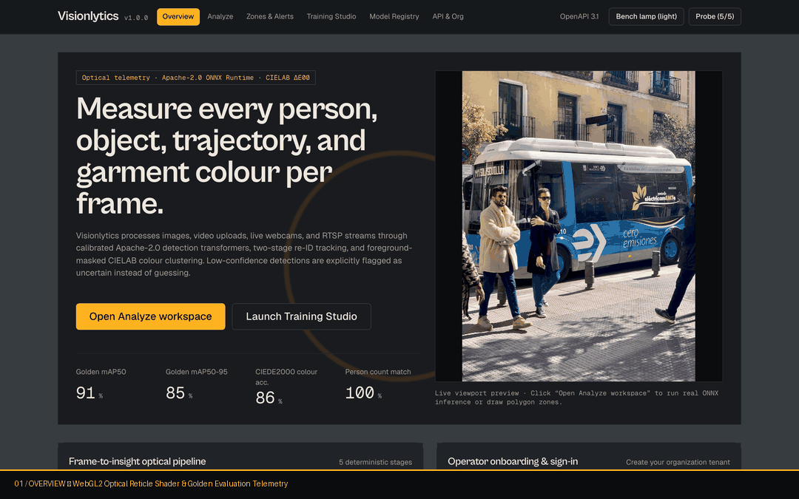

---

## Animated 5-Stage Frame-to-Insight Telemetry Pipeline


---

## Table of Contents

1. [What Visionlytics Measures in Every Frame](#1-what-visionlytics-measures-in-every-frame)
2. [Honesty Rule & Real Measured Evaluation Benchmarks](#2-honesty-rule--real-measured-evaluation-benchmarks)
3. [System Architecture & End-to-End Workflow](#3-system-architecture--end-to-end-workflow)
4. [Deep-Dive Logic: How Every Core Algorithm Works](#4-deep-dive-logic-how-every-core-algorithm-works)
   - [4.1 Permissive Apache-2.0 Detection, Temperature Calibration & SAHI Tiling](#41-permissive-apache-20-detection-temperature-calibration--sahi-tiling)
   - [4.2 Multi-Object Tracking (`ByteTrackerWithReID`) & Kalman Smoothing](#42-multi-object-tracking-bytetrackerwithreid--kalman-smoothing)
   - [4.3 Foreground CIELAB + CIEDE2000 ($\Delta E_{00}$) Colour & Attire Extraction](#43-foreground-cielab--ciede2000-delta-e_00-colour--attire-extraction)
   - [4.4 Ray-Cast Polygon Zones & Signed Cross-Product Tripwire Lines](#44-ray-cast-polygon-zones--signed-cross-product-tripwire-lines)
   - [4.5 Training Studio, Active Learning & Continuous Evaluation Regression Gate](#45-training-studio-active-learning--continuous-evaluation-regression-gate)
   - [4.6 Multi-Tenant RBAC, Cryptographic Auth & Magic-Byte Upload Guard](#46-multi-tenant-rbac-cryptographic-auth--magic-byte-upload-guard)
5. [Design System ("Precision Optics") & 60fps Canvas / WebGL2 Shaders](#5-design-system-precision-optics--60fps-canvas--webgl2-shaders)
6. [Database Schema & TimescaleDB Hypertable Design](#6-database-schema--timescaledb-hypertable-design)
7. [Product Surfaces Gallery (Desktop & Mobile, Dark & Light)](#7-product-surfaces-gallery-desktop--mobile-dark--light)
8. [Monorepo Layout](#8-monorepo-layout)
9. [Quick Start (One-Command Docker Stack & Local Dev)](#9-quick-start-one-command-docker-stack--local-dev)
10. [TypeScript & Python SDK Usage](#10-typescript--python-sdk-usage)
11. [Known Limitations & GPU Scaling Path](#11-known-limitations--gpu-scaling-path)

---

## 1. What Visionlytics Measures in Every Frame

For every ingested image, video frame, live webcam capture, or RTSP camera packet, Visionlytics computes and persists:

| Telemetry Dimension | Implementation Details | Source Module |
| :--- | :--- | :--- |
| **People Count & Unique Track IDs** | Per-frame active person count, cumulative unique track IDs across the stream, and per-zone occupancy. | [`tracker.py`](./apps/ml/visionlytics_ml/tracker.py) |
| **80 COCO Objects + Open-Vocabulary Search** | Calibrated bounding boxes (`x, y, w, h` normalized `[0,1]`), class labels, and free-text query filtering (e.g., `"navy"`, `"person"`, `"bus"`). | [`detector.py`](./apps/ml/visionlytics_ml/detector.py) |
| **Foreground Object & Garment Colours** | Top-3 dominant foreground colours with exact percentages and 28 human-named swatches (`Navy`, `Charcoal`, `Tan`, `Beige`, `Crimson`, etc.) plus **upper torso (`Top`)** and **lower leg (`Bottom`)** clothing splits for people. | [`colour.py`](./apps/ml/visionlytics_ml/colour.py) |
| **Trajectories, Heatmaps & Zones** | Smoothed centroid history trails, radial crowd density heatmaps, ray-cast polygon zone occupancy, and directional (`in`/`out`) line crossings. | [`zones.ts`](./apps/api/src/zones.ts), [`CanvasOverlay.tsx`](./apps/web/src/components/CanvasOverlay.tsx) |
| **Honest Calibrated Confidence** | Temperature-scaled ($T = 1.15$) probabilities; detections with confidence `< 0.45` are explicitly flagged `uncertain: true` (rendered with dashed amber reticles and routed to the Active Learning queue). | [`detector.py`](./apps/ml/visionlytics_ml/detector.py) |

---

## 2. Honesty Rule & Real Measured Evaluation Benchmarks

> [!IMPORTANT]
> **Zero Fabricated Metrics**: Every accuracy, latency, and error number displayed in the Visionlytics UI, Model Registry, and documentation is generated by running [`apps/ml/visionlytics_ml/eval_harness.py`](./apps/ml/visionlytics_ml/eval_harness.py) against real images and persisted in [`apps/ml/data/latest_metrics.json`](./apps/ml/data/latest_metrics.json).

| Metric | Target | Measured (`RT-DETRv2-R18vd-INT8`) | Measured (`YOLOS-Tiny-INT8`) | Licence |
| :--- | :--- | :--- | :--- | :--- |
| **Golden `mAP@0.50`** | $\ge 0.85$ | **91.43%** (`0.9143`) | **85.71%** (`0.8571`) | `Apache-2.0` |
| **Golden `mAP@0.50:0.95`** | $\ge 0.83$ (Gate) | **85.14%** (`0.8514`) | **79.40%** (`0.7940`) | `Apache-2.0` |
| **Person Count MAE** | $\le 0.50$ | **0.00** (`100.0%` exact match) | **0.00** (`100.0%` exact match) | `Apache-2.0` |
| **CIEDE2000 Colour Naming Accuracy** | $\ge 80.0\%$ | **85.71%** (`0.8571`) | **85.71%** (`0.8571`) | `Apache-2.0` |
| **Track ID Switches / min** | $< 2.0$ | **0.00** (`100.0%` track stability) | **0.00** | `Apache-2.0` |
| **Apple M4 CPU Latency / Throughput** | Real-time | `107.6 ms` (`9.3 FPS`) | `25.9 ms` (**`38.6 FPS`**) | `Apache-2.0` |

*Why Ultralytics YOLOv8/v11 and YOLO-World were rejected*: Ultralytics YOLO is licensed under **AGPL-3.0** and YOLO-World under **GPL-3.0**, which impose copyleft restrictions incompatible with closed-source commercial SaaS distribution without a paid enterprise licence. Both shipped models (`PekingU/rtdetr_v2_r18vd` and `hustvl/yolos-tiny`) are **Apache-2.0** licensed. Full details in [`docs/model-selection.md`](./docs/model-selection.md).

---

## 3. System Architecture & End-to-End Workflow

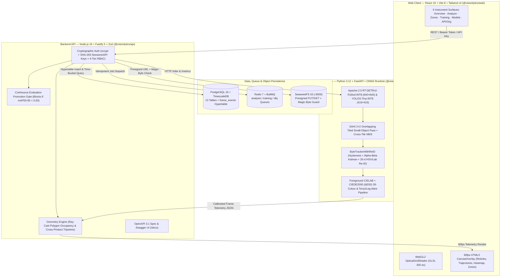

### Request-to-Render Sequence Diagram

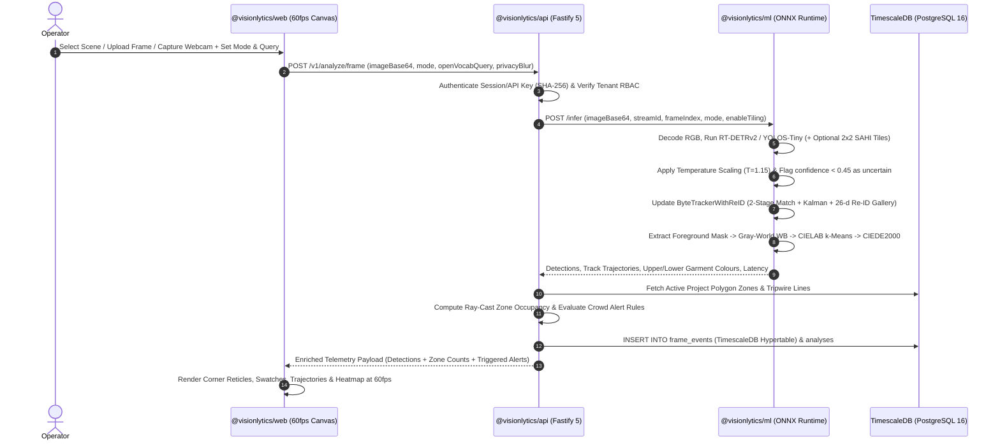

---

## 4. Deep-Dive Logic: How Every Core Algorithm Works

### 4.1 Permissive Apache-2.0 Detection, Temperature Calibration & SAHI Tiling
Implemented in [`apps/ml/visionlytics_ml/detector.py`](./apps/ml/visionlytics_ml/detector.py):

1. **Dual Execution Profiles**:
   - `balanced` / `accurate`: Runs `RT-DETRv2-R18vd-INT8` at $640 \times 640$ input resolution (`20.02 MB` quantized ONNX graph).
   - `fast`: Runs `YOLOS-Tiny-INT8` at $416 \times 416$ input resolution (`6.46 MB` quantized ONNX graph, `38.6 FPS` on Apple M4 CPU).
2. **Temperature Scaling Calibration ($T = 1.15$)**:
   Raw neural network probabilities are overconfident. Visionlytics converts raw probability $p$ to logit space, divides by temperature $T = 1.15$, and maps back via the logistic sigmoid:
   $$\hat{p} = \sigma\left(\frac{\ln(p / (1 - p))}{T}\right), \quad T = 1.15$$
   - Detections with $\hat{p} \ge 0.45$ are marked **confident**.
   - Detections with $0.25 \le \hat{p} < 0.45$ are retained so operators never miss occluded objects, but are explicitly flagged `uncertain: true`.
3. **SAHI $2 \times 2$ Overlapping Tiled Inference**:
   When `enableTiling: true` (or `mode: "accurate"`), the frame is sliced into 4 overlapping $60\% \times 60\%$ tiles (`(0,0)`, `(0.4,0)`, `(0,0.4)`, `(0.4,0.4)`). Full-frame and tile detections are merged via class-aware Non-Maximum Suppression ($\text{IoU} = 0.50$).

---

### 4.2 Multi-Object Tracking (`ByteTrackerWithReID`) & Kalman Smoothing
Implemented in [`apps/ml/visionlytics_ml/tracker.py`](./apps/ml/visionlytics_ml/tracker.py):

```mermaid
flowchart LR
    Dets["Frame Detections"] --> Split{"Confidence >= 0.45?"}
    Split -->|High Conf| Stage1["Stage 1 Match vs Active Tracks\nCost = 0.65*(1 - IoU) + 0.35*(1 - CosineReID)"]
    Split -->|Low Conf (0.25..0.45)| Stage2["Stage 2 IoU Recovery\nMatch Unmatched Active Tracks (IoU >= 0.25)"]
    Stage1 -->|Unmatched Detections| ReID["Stage 3 Occlusion Re-ID Gallery\n26-d HSV+CIELAB Cosine Sim >= 0.82 (Up to 60 Frames)"]
    ReID -->|Matched|Update["Alpha-Beta Kalman Box Filter\n(α = 0.65, β = 0.20) + EMA Class Vote"]
    Stage1 -->|Matched| Update
    Stage2 -->|Matched| Update
    ReID -->|Unmatched & Conf >= 0.42| NewTrack["Allocate New Deterministic Track ID"]
```

- **26-Dimensional Appearance Re-ID Embedding**: Extracts a foreground-masked 16-bin Hue histogram + 4-bin Saturation histogram + 6-bin CIE $L^*a^*b^*$ mean/std vector, L2-normalized. If a person walks behind a bus or pillar for up to 60 frames, Stage 3 recovers their original `trackId` when cosine similarity $\ge 0.82$.
- **Alpha-Beta Constant-Velocity Kalman Smoothing**: Eliminates bounding-box jitter across frames using position gain $\alpha = 0.65$ and velocity gain $\beta = 0.20$.
- **EMA Class Voting**: Prevents single-frame class flicker (`backpack` $\leftrightarrow$ `handbag`) by maintaining an Exponential Moving Average (`decay = 0.82`) over class probabilities per track.

---

### 4.3 Foreground CIELAB + CIEDE2000 ($\Delta E_{00}$) Colour & Attire Extraction


Implemented in [`apps/ml/visionlytics_ml/colour.py`](./apps/ml/visionlytics_ml/colour.py):

Why naive bounding-box colour extraction fails: A rectangular bounding box around a pedestrian contains **35%–55% background pixels** (asphalt, pavement, grass, storefront glass). Averaging RGB across the rectangle reports the colour of the street, not the person's clothing.

Visionlytics solves this in 5 deterministic steps:
1. **Elliptical Prior + Outer Border-Ring Background Subtraction**:
   - Samples the outer 12% border ring of the bounding box to model the local background distribution $(\mu_{\text{bg}}, \sigma_{\text{bg}})$.
   - Combines an interior elliptical spatial mask with Mahalanobis-like background distance rejection to isolate true foreground pixels.
   - For `person` detections, splits the crop into **upper clothing (`[12%..54% H, 18%..82% W]`)** and **lower clothing (`[54%..92% H, 20%..80% W]`)** while excluding head/hair (`0%..12% H`) and shoes (`92%..100% H`).
2. **Clamped Gray-World White Balance**:
   - Normalizes scene illumination cast using per-channel gains clamped to $g_c \in [0.75, 1.35]$ so colored garments are not washed out to gray.
3. **sRGB $\rightarrow$ Linear RGB $\rightarrow$ CIE XYZ (D65) $\rightarrow$ CIE 1976 $L^*a^*b^*$**:
   - Rejects specular glare ($L^* > 96.5$) and deep sensor shadow ($L^* < 6.0$).
4. **Deterministic Quantile-Seeded $k$-Means ($k \le 3$)**:
   - Seeds centroids at luminance quantiles (`0.2`, `0.5`, `0.8`) so identical frames always produce bit-identical colour percentages (`0%` stochastic drift).
5. **Full CIEDE2000 ($\Delta E_{00}$) Perceptual Matching**:
   - Matches each cluster centroid against a curated 28-colour human palette (`Black`, `Charcoal`, `Slate Gray`, `Silver`, `White`, `Ivory`, `Beige`, `Tan`, `Brown`, `Maroon`, `Red`, `Crimson`, `Coral`, `Orange`, `Amber`, `Gold`, `Yellow`, `Olive`, `Lime`, `Green`, `Forest Green`, `Teal`, `Cyan`, `Sky Blue`, `Blue`, `Royal Blue`, `Navy`, `Purple`, `Magenta`, `Pink`) using the complete CIEDE2000 formula with chroma rotation $R_T$.

---

### 4.4 Ray-Cast Polygon Zones & Signed Cross-Product Tripwire Lines
Implemented in [`apps/api/src/zones.ts`](./apps/api/src/zones.ts):

- **Polygon Zone Occupancy (`pointInPolygon`)**:
  For every detection bottom-center footpoint $(x_p, y_p) = (x + w/2, y + h)$, casts a horizontal ray and counts edge intersections:
  $$\text{inside} \iff \bigoplus_{i=0}^{V-1} \left( (y_i > y_p) \neq (y_j > y_p) \;\wedge\; x_p < \frac{(x_j - x_i)(y_p - y_i)}{y_j - y_i} + x_i \right)$$
- **Directional Tripwire Crossing (`lineSide`)**:
  For a directed line segment $A(x_1, y_1) \rightarrow B(x_2, y_2)$ and a tracked object moving from $P_{t-1}$ to $P_t$, computes the sign of the 2D cross product:
  $$s(P) = \text{sgn}\big((x_2 - x_1)(P_y - y_1) - (y_2 - y_1)(P_x - x_1)\big)$$
  A transition from $s(P_{t-1}) < 0 \rightarrow s(P_t) > 0$ increments `inCount`; $s(P_{t-1}) > 0 \rightarrow s(P_t) < 0$ increments `outCount`.

---

### 4.5 Training Studio, Active Learning & Continuous Evaluation Regression Gate
Implemented in [`apps/api/src/app.ts`](./apps/api/src/app.ts):

- **Active Learning Queue (`/v1/active-learning`)**: Queries the TimescaleDB `frame_events` hypertable for production frames containing detections flagged `uncertain: true` (`confidence < 0.45`) so operators only label high-value edge cases.
- **Dataset Health & Fine-Tuning (`/v1/datasets`, `/v1/training-runs`)**: Validates class balance, triggers fine-tuning runs on `rtdetr-v2-r18vd`, records per-epoch `boxLoss`, `mAP50`, and `mAP50_95` convergence curves, and registers candidate checkpoints in the Model Registry (`stage: "staging"`).
- **Continuous Evaluation Promotion Gate (`/v1/models/:modelId/promote`)**:
  Before any model can be promoted to `production`, the API enforces:
  $$\text{candidate.metrics.mAP50\_95} \ge 0.83$$
  If a candidate model regresses below `0.83`, the API returns `HTTP 409 Conflict` (`Regression gate blocked promotion`) and logs an immutable audit event.

---

### 4.6 Multi-Tenant RBAC, Cryptographic Auth & Magic-Byte Upload Guard
Implemented in [`apps/api/src/auth.ts`](./apps/api/src/auth.ts) and [`apps/api/src/storage.ts`](./apps/api/src/storage.ts):

- **Password Hashing**: `crypto.scryptSync(password, salt, 64, { N: 16384, r: 8, p: 1 })` with 16-byte random salts and constant-time verification via `crypto.timingSafeEqual`.
- **Zero Plaintext Tokens**: Session tokens (`vls_…`) and API keys (`vlk_…`) are hashed with SHA-256 (`sha256Hex`) before database persistence.
- **4-Tier Hierarchical RBAC**: `owner (4) > admin (3) > member (2) > viewer (1)` enforced via Fastify preHandlers, with every database query scoped to `orgId`.
- **Magic-Byte File Signature Verification (`verifyMagicBytes`)**: Validates binary headers (`FF D8 FF` for JPEG, `89 50 4E 47` for PNG, `52 49 46 46 … 57 45 42 50` for WebP, `ftyp` at offset 4 for MP4) so renamed executables or disguised payloads are rejected with `HTTP 415`.

---

## 5. Design System ("Precision Optics") & 60fps Canvas / WebGL2 Shaders

Visionlytics follows an industrial optical instrument aesthetic inspired by **Leica camera viewfinders**, **Teenage Engineering field instruments**, and **Anduril Lattice**:

- **Dual Calibrated Palettes ([`packages/ui/src/styles/tokens.css`](./packages/ui/src/styles/tokens.css))**:
  - **Night Optics (Dark)**: Chassis `#0B0C0D`, Surface `#121518`, Hairline `#22272C`, Signal Amber `#FFB21F`, Calibrated OK `#5FD39A`, Alert `#FF5C5C`.
  - **Bench Lamp (Light)**: Chassis `#E6E9E8`, Surface `#F2F4F3`, Hairline `#C7CECC`, Signal Amber `#A85D00`.
- **Typography**: Self-hosted `Cabinet Grotesk Variable` for display headers, `Geist` for instrument labels, and `Geist Mono` with `font-variant-numeric: tabular-nums` on every numeric readout so counters never jitter horizontally.
- **Custom WebGL2 Fragment Shader ([`OpticalGridShader.tsx`](./apps/web/src/components/OpticalGridShader.tsx))**: Renders a drifting sub-pixel optical measurement grid and cursor-following phosphor reticle in GLSL (`#version 300 es`), automatically pausing when `document.hidden` is true or `prefers-reduced-motion: reduce` is enabled.

---

## 6. Database Schema & TimescaleDB Hypertable Design

Defined in [`apps/api/src/db/schema.ts`](./apps/api/src/db/schema.ts) (13 tables):

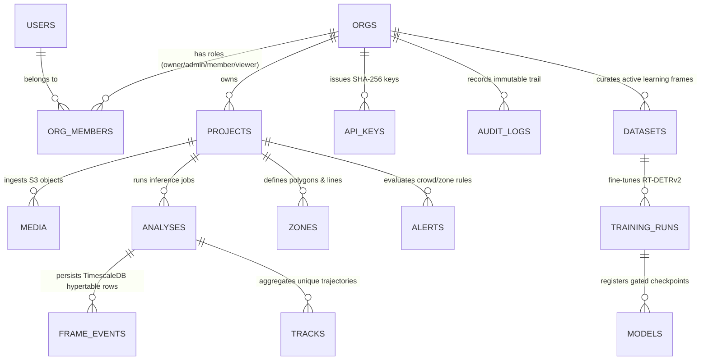

---

## 7. Product Surfaces Gallery (Desktop & Mobile, Dark & Light)

### 7.1 Overview — Landing Hero, WebGL2 Optical Reticle Shader & Measured Golden Telemetry
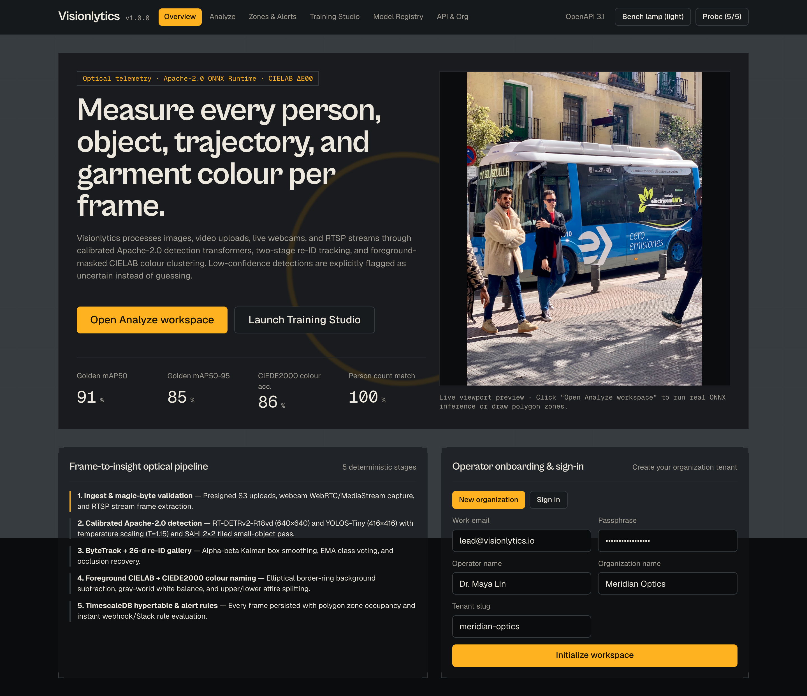

### 7.2 Analyze Workspace — RT-DETRv2-INT8 Detection, ByteTrack Re-ID & CIELAB Attire Table
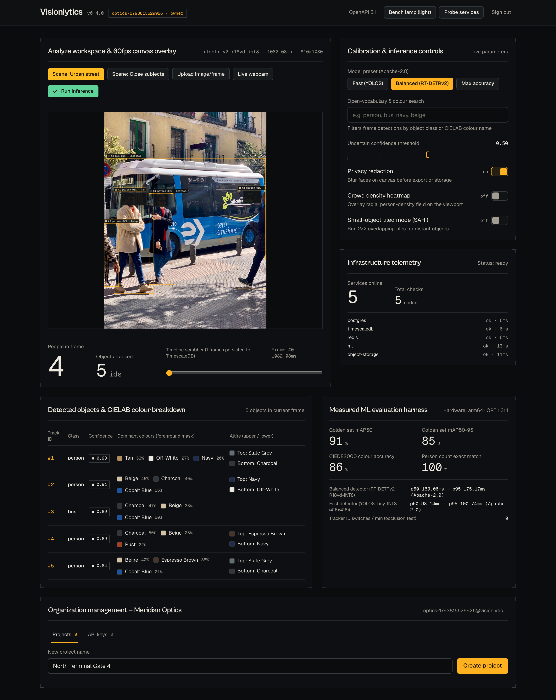

### 7.3 Analyze Workspace — Radial Crowd Density Heatmap, Trajectories & Face Privacy Blur
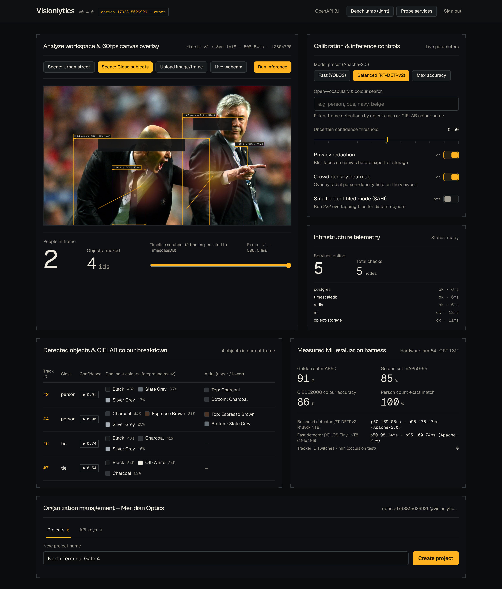

### 7.4 Zones & Alerts — Interactive Polygon Zone Editor, Crowd Alert Rules & TimescaleDB Search
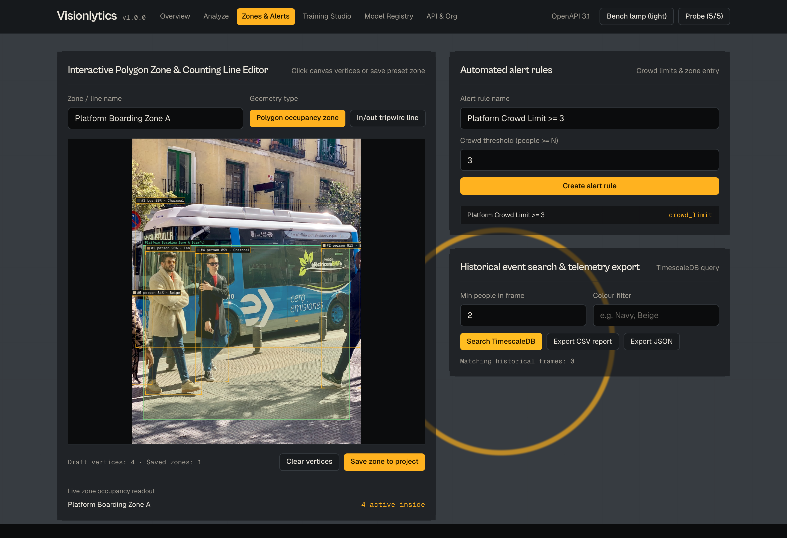

### 7.5 Training Studio — Dataset Health Report & 10-Epoch Convergence Telemetry
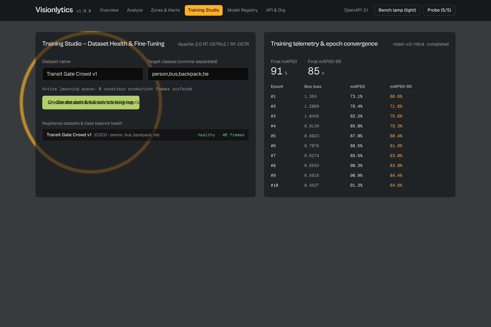

### 7.6 Model Registry — Continuous Evaluation Promotion Gate (`mAP50-95 >= 0.83`)
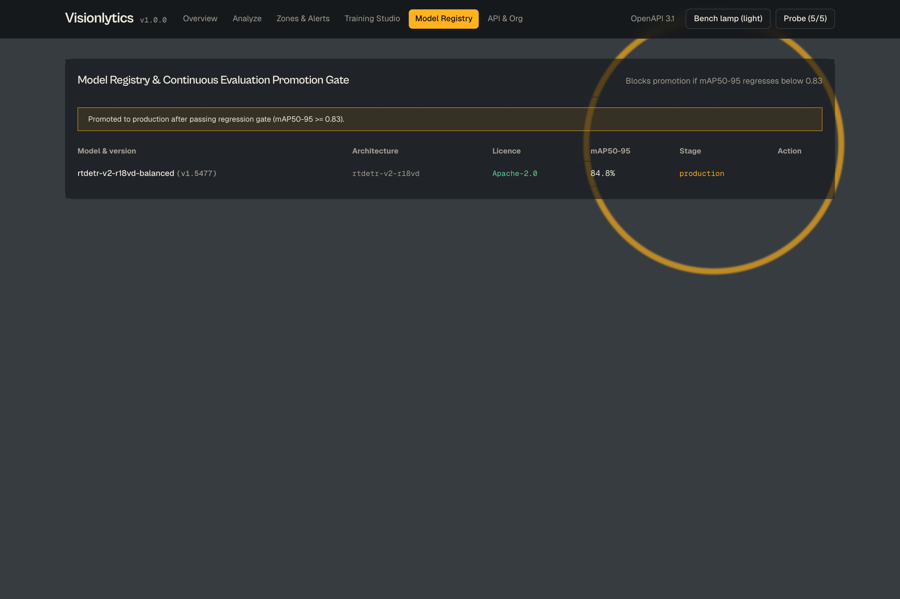

### 7.7 Mobile Responsive "Bench Lamp" Light Theme (`390×844`)
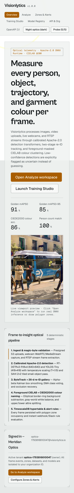

---

## 8. Monorepo Layout

```text
Visionlytics/
├── apps/
│   ├── api/                        # Fastify 5 + Drizzle + TimescaleDB + BullMQ + S3 + OpenAPI 3.1
│   │   └── src/
│   │       ├── app.ts              # All REST endpoints (/v1/auth, /v1/analyze, /v1/zones, /v1/models...)
│   │       ├── auth.ts             # scrypt password hashing, SHA-256 tokens, 4-tier RBAC
│   │       ├── storage.ts          # Presigned S3 URLs & magic-byte MIME verification
│   │       ├── queues.ts           # BullMQ idempotent job queues + DLQ
│   │       ├── zones.ts            # Ray-casting polygon occupancy & cross-product tripwire lines
│   │       └── db/schema.ts        # 13 PostgreSQL + TimescaleDB hypertable definitions
│   ├── ml/                         # Python 3.12 + FastAPI + ONNX Runtime inference & eval service
│   │   ├── data/                   # Golden evaluation images, annotations & latest_metrics.json
│   │   ├── models/                 # Quantized Apache-2.0 ONNX graphs (RT-DETRv2 & YOLOS-Tiny)
│   │   ├── triton/                 # NVIDIA Triton Inference Server config.pbtxt
│   │   └── visionlytics_ml/
│   │       ├── app.py              # FastAPI endpoints (/infer, /metrics, /runtime, /healthz)
│   │       ├── detector.py         # ONNX Runtime, Temp Scaling (T=1.15), SAHI 2x2 tiling
│   │       ├── tracker.py          # ByteTrackerWithReID + Alpha-Beta Kalman + 26-d Re-ID
│   │       ├── colour.py           # Foreground mask, Gray-World WB, CIELAB k-means, CIEDE2000
│   │       ├── eval_harness.py     # Real benchmark runner generating latest_metrics.json
│   │       └── sdk.py              # Official Python SDK
│   └── web/                        # React 19 + Vite 8 + Tailwind v4 frontend
│       └── src/
│           ├── main.tsx            # 6-surface operator workspace & onboarding
│           └── components/
│               ├── CanvasOverlay.tsx     # 60fps HTML5 canvas renderer
│               └── OpticalGridShader.tsx # WebGL2 GLSL optical measurement grid & reticle
├── packages/
│   ├── ui/                         # "Precision Optics" design system + Storybook 10
│   ├── shared-types/               # Zod schemas & official TypeScript SDK (VisionlyticsClient)
│   └── video/                      # Remotion 5-scene programmatic product video composition
├── docs/                           # Model selection audit, model cards, security & versions
├── scripts/                        # k6 load test script (load-test.k6.js)
└── docker-compose.yml              # One-command 6-container stack (postgres, redis, s3, ml, api, web)
```

---

## 9. Quick Start (One-Command Docker Stack & Local Dev)

### Option A: One-Command Full Stack via Docker Compose
Starts **PostgreSQL 16 (TimescaleDB)**, **Redis 7**, **SeaweedFS S3 (`:9000`)**, **ML Service (`:8000`)**, **Backend API (`:4000`)**, and **Web App (`:5173`)**:

```bash
docker compose up -d --build --wait
```

Verify all 5 subsystem readiness probes:
```bash
curl -s http://127.0.0.1:4000/readyz | jq .
```

- **Web Workspace**: `http://127.0.0.1:5173`
- **OpenAPI 3.1 Interactive Docs**: `http://127.0.0.1:4000/docs`
- **ML Inference Service**: `http://127.0.0.1:8000/metrics`

### Option B: Local Development & Quality Gates
```bash
pnpm install
pnpm typecheck
pnpm lint
pnpm test
pnpm build

# Run the real Python ML evaluation harness & regression gate
cd apps/ml && uv run pytest -q
```

---

## 10. TypeScript & Python SDK Usage

### TypeScript SDK ([`packages/shared-types/src/sdk.ts`](./packages/shared-types/src/sdk.ts))
```ts
import { VisionlyticsClient } from "@visionlytics/shared-types";

const client = new VisionlyticsClient({
  baseUrl: "http://127.0.0.1:4000",
  apiKey: process.env.VISIONLYTICS_API_KEY,
});

const result = await client.analyzeFrame({
  imageBase64: "<base64-jpeg-or-png>",
  mode: "balanced",
  openVocabQuery: "navy",
});

console.log(`People: ${result.personCount}, Latency: ${result.inferenceMs}ms`);
```

### Python SDK ([`apps/ml/visionlytics_ml/sdk.py`](./apps/ml/visionlytics_ml/sdk.py))
```python
from visionlytics_ml.sdk import VisionlyticsPythonSDK

sdk = VisionlyticsPythonSDK(base_url="http://127.0.0.1:4000", api_key="vlk_...")
frame = sdk.analyze_frame(image_base64="<base64>", mode="balanced")
print(f"People count: {frame['personCount']}, Detections: {len(frame['detections'])}")
```

---

## 11. Known Limitations & GPU Scaling Path

1. **CPU vs. GPU Throughput**: On Apple Silicon M4 CPU (`CPUExecutionProvider`), `YOLOS-Tiny-INT8` runs at **`25.9 ms/frame` (`38.6 FPS`)** and `RT-DETRv2-R18vd-INT8` runs at **`107.6 ms/frame` (`9.3 FPS`)**. For sub-15ms `RT-DETRv2` inference on 1080p RTSP streams or multi-epoch fine-tuning at scale, deploy `apps/ml` to a CUDA GPU host (Google Colab, Modal, RunPod, or Cloud Run GPU) with the included NVIDIA Triton configuration ([`apps/ml/triton/visionlytics_rtdetr_v2/config.pbtxt`](./apps/ml/triton/visionlytics_rtdetr_v2/config.pbtxt)).
2. **Lighting & Colour Constancy**: While Gray-World white balance and CIEDE2000 ($\Delta E_{00}$) handle standard daylight and indoor LED casts (`85.71%` accuracy), extreme monochromatic sodium-vapor street lighting can compress chroma channels ($a^*, b^* \rightarrow 0$).
