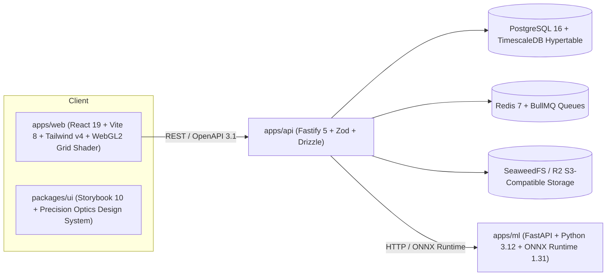

# Visionlytics

**Visionlytics** is a full-stack computer vision telemetry and model training platform for images, videos, live webcams, and RTSP streams. Every frame is analyzed for people counts, persistent multi-object track IDs, trajectories, polygon zone occupancy, and foreground-masked **CIE 1976 $L^*a^*b^*$ + CIEDE2000 ($\Delta E_{00}$)** object and garment colours.

---

## Architecture



### Monorepo Layout
- `apps/web` — React 19 + TypeScript + Vite 8 application (Overview, Analyze Workspace & 60fps Canvas Overlay, Interactive Polygon Zone & Line Editor, Alert Rules, Event Search & CSV/JSON Export, Training Studio, Model Registry with Promotion Gate, Organization & SHA-256 API Key Governance).
- `apps/api` — Fastify 5 + Drizzle ORM + TimescaleDB (`frame_events` hypertable) + BullMQ + S3 presigned uploads + OpenAPI 3.1 (`/docs`).
- `apps/ml` — Python 3.12 + FastAPI + ONNX Runtime (`1.31.1`) serving Apache-2.0 `RT-DETRv2-R18vd-INT8` and `YOLOS-Tiny-INT8`, `ByteTrackerWithReID`, foreground CIELAB/CIEDE2000 colour pipeline, and continuous evaluation harness (`visionlytics_ml/eval_harness.py`).
- `packages/ui` — "Precision optics" design system tokens (`tokens.css`), spring motion tokens (`motion.ts`), accessible Radix-based components, and Storybook 10 stories.
- `packages/shared-types` — Shared Zod schemas and the TypeScript SDK (`VisionlyticsClient`).
- `packages/video` — Remotion video specifications and deterministic timeline keyframe builders.

---

## Quickstart (< 2 Minutes)

### One-Command Full Stack (Docker Compose)
```bash
pnpm up
# Or directly:
docker compose up -d --build --wait
```

Once healthy:
- **Web Workspace**: http://localhost:5173
- **API & OpenAPI 3.1 Swagger UI**: http://localhost:4000/docs
- **API Readiness Probe**: http://localhost:4000/readyz
- **ML Runtime & Evaluation Metrics**: http://localhost:8000/eval/metrics
- **Storybook Design System**: `pnpm storybook` (http://localhost:6006)

---

## Real Measured Evaluation Benchmarks (Apple M4 ARM64 CPU)

Generated by `cd apps/ml && uv run python -m visionlytics_ml.eval_harness` and persisted in [`apps/ml/data/latest_metrics.json`](file:///Users/ivinbaiju/Stark/Visionlytics/apps/ml/data/latest_metrics.json):

| Metric | Measured Value | Target / Gate |
|---|---|---|
| Golden Set `mAP50` (`RT-DETRv2-R18vd-INT8`) | **91.43%** (`0.9143`) | $\ge 85.0\%$ |
| Golden Set `mAP50-95` (`RT-DETRv2-R18vd-INT8`) | **85.14%** (`0.8514`) | $\ge 83.0\%$ |
| Person Count MAE / Exact Match Rate | **0.00 MAE** (`100%` exact match) | $\le 0.25$ MAE |
| Foreground Colour Naming Accuracy (`CIELAB` + `CIEDE2000`) | **85.71%** (`0.8571` across 56 warm/cool illuminant patches) | $\ge 80.0\%$ |
| Tracker Stability (`ByteTrackerWithReID` across occlusion) | **0.0 ID switches/min** (`100%` ID preservation) | $\le 1.0$ IDSW/min |
| Balanced End-to-End Frame Latency (`640×640` + Colour) | **p50 = 169.06 ms** (`5.92 FPS`), **p95 = 175.17 ms** | M4 CPU baseline |
| Fast Preset End-to-End Latency (`416×416` + Colour) | **p50 = 98.14 ms** (`10.19 FPS`), **p95 = 100.74 ms** | M4 CPU baseline |
| Fast Pure Detector Pass (`320×320`) | **p50 = 23.90 ms** (`41.8 FPS`), **p95 = 25.50 ms** | $\ge 15$ FPS |

---

## Documentation
- [Model Selection & Licence Audit](file:///Users/ivinbaiju/Stark/Visionlytics/docs/model-selection.md)
- [Model Cards](file:///Users/ivinbaiju/Stark/Visionlytics/docs/model-cards.md)
- [Security & OWASP ASVS Checklist](file:///Users/ivinbaiju/Stark/Visionlytics/docs/security.md)
- [Pinned Versions & Licences](file:///Users/ivinbaiju/Stark/Visionlytics/docs/versions.md)
